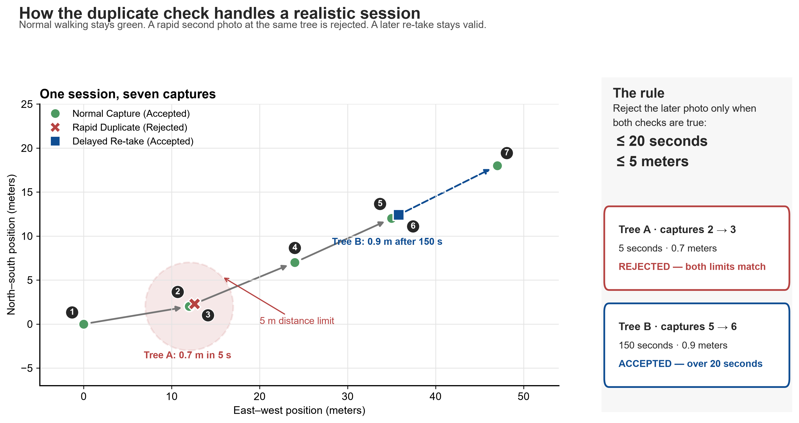

# Spotting rapid duplicate tree captures

## The Problem

A planter can sometimes take several photos of the same tree within a few seconds. That may be an honest double tap, a slow phone, or an attempt to make one tree look like several completed captures.

Either way, those extra records are a problem. If every photo is treated as a separate tree, the same work can be counted and paid for more than once. It also makes survival and planting reports less trustworthy.

This check catches the clearest cases early, before an unprocessed capture moves further through the system.

## The Logic (Simple and Deterministic)

We look at captures in time order within one session. For each capture, we compare it with the capture immediately before it.

The later capture is rejected only when both of these statements are true:

1. It was taken no more than 20 seconds later.
2. It was taken no more than 5 meters away.

When both limits match, the later row is updated like this:

```text
status = 'rejected'
rejection_reason = 'duplicate_intra_session'
```

If either check does not match, the capture stays untouched. A photo taken at the same place two minutes later is not rejected by this rule. A photo taken 15 meters away after ten seconds is not rejected either, because the planter has moved beyond the 5-meter limit.

The update also checks that the row is still `unprocessed`. This matters when two jobs overlap: a capture that another process has already handled will not be overwritten.

## Why This Instead of a Complex AI or Phone-Sensor Model?

The short answer is that we do not need a complicated model to catch this pattern.

An AI model or motion-sensor system would need more data from the phone, more tuning, and more ways to recover when data is missing. That is a poor fit for low-cost phones and unreliable connections. It would also make a rejection harder to explain to a planter or support team.

Here the phone does no extra work. PostgreSQL puts each capture next to the previous capture from the same session, and PostGIS measures the distance. PostGIS is simply the distance calculator already available inside the database.

That gives us a few practical benefits:

- No model server, GPU, or new phone-side processing.
- One clear reason for every rejection: close in time and close in distance.
- Thresholds that can be reviewed and changed without retraining anything.
- A single ordered pass instead of comparing every capture with every other capture.

For one session, this is the kind of small database operation that should normally finish very quickly. We have not published a production benchmark yet, so we should measure real runtimes on production-sized data before claiming a specific millisecond figure.

This rule is intentionally narrow. It does not claim that two photos show the same tree. It only flags the strongest rapid-repeat pattern. Borderline cases can continue through the normal review process.

## Visual Example

The numbered markers below show capture order. Green circles are normal walking captures. The red cross is a second photo taken 5 seconds and less than 1 meter after capture 2, so it is rejected. The blue square is near Tree B but arrives 150 seconds later, so it stays accepted.



The red dashed circle shows the 5-meter distance limit. Distance alone is not enough: the 20-second limit must also match.
